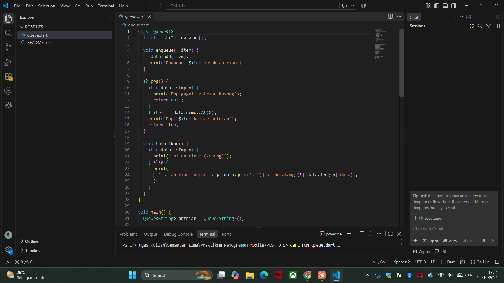
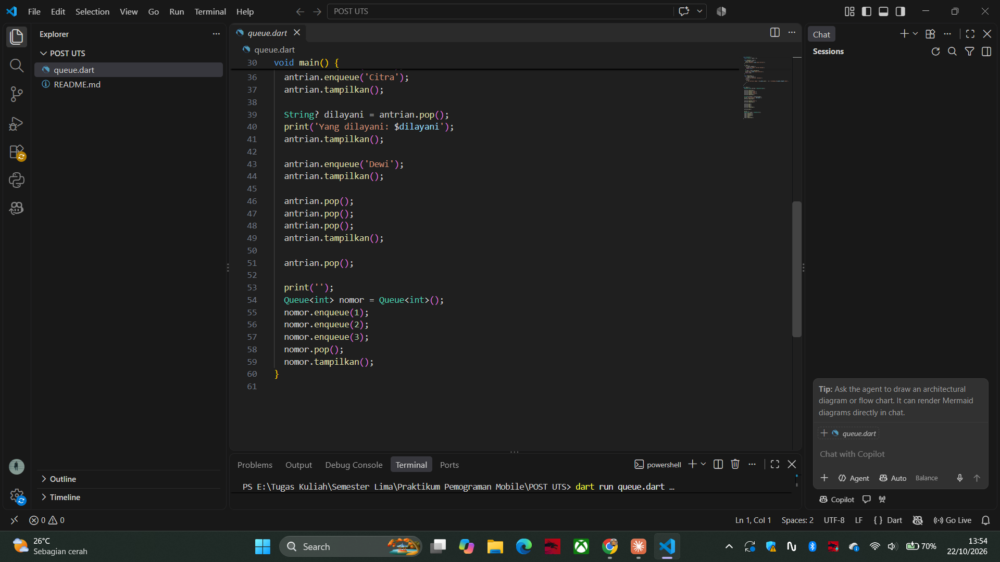
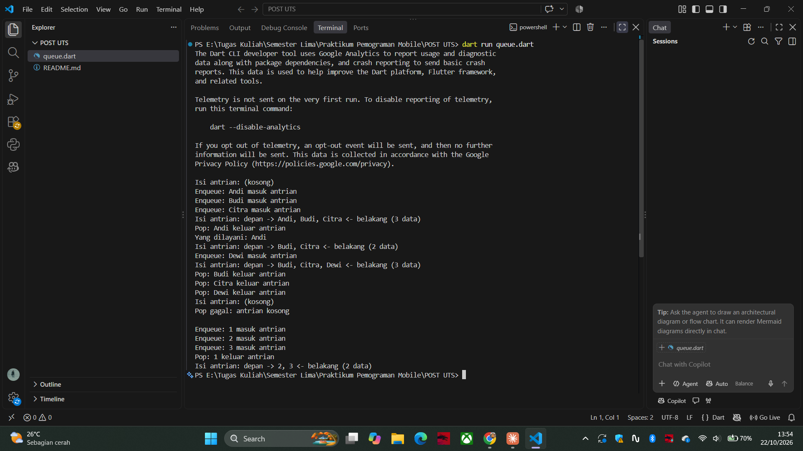

# Queue (Antrian) dengan Dart

| | |
|---|---|
| Nama | Hafizh Naufal Raditya |
| NIM | H1D024061 |

Tugas Praktikum Pemrograman Mobile: membuat class `Queue` (antrian) dengan metode `enqueue` dan `pop` menggunakan Dart.

## Cara Kerja

Queue bekerja dengan prinsip **FIFO (First In, First Out)**: data yang pertama masuk adalah data yang pertama keluar, seperti antrian di kasir.

| Metode | Fungsi |
|---|---|
| `enqueue(item)` | Menambahkan data ke belakang antrian dengan `add` |
| `pop()` | Mengeluarkan data paling depan dengan `removeAt(0)`. Jika antrian kosong, mengembalikan `null` |
| `tampilkan()` | Menampilkan isi antrian dari depan ke belakang beserta jumlah datanya |

- Data disimpan di `List<T> _data`. Tanda `_` membuat list ini private, sehingga isi antrian hanya bisa diubah lewat `enqueue` dan `pop`.
- `<T>` membuat class ini bisa dipakai untuk tipe data apa saja, misalnya `Queue<String>` untuk nama dan `Queue<int>` untuk nomor antrian.
- Tipe kembalian `pop()` adalah `T?` karena hasilnya bisa `null` saat antrian kosong.

## Cara Menjalankan

```bash
dart run queue.dart
```

Kode juga bisa ditempel langsung ke [DartPad](https://dartpad.dev).

## Screenshot

### Kode





### Hasil Run



Output dalam bentuk teks:

```
Isi antrian: (kosong)
Enqueue: Andi masuk antrian
Enqueue: Budi masuk antrian
Enqueue: Citra masuk antrian
Isi antrian: depan -> Andi, Budi, Citra <- belakang (3 data)
Pop: Andi keluar antrian
Yang dilayani: Andi
Isi antrian: depan -> Budi, Citra <- belakang (2 data)
Enqueue: Dewi masuk antrian
Isi antrian: depan -> Budi, Citra, Dewi <- belakang (3 data)
Pop: Budi keluar antrian
Pop: Citra keluar antrian
Pop: Dewi keluar antrian
Isi antrian: (kosong)
Pop gagal: antrian kosong

Enqueue: 1 masuk antrian
Enqueue: 2 masuk antrian
Enqueue: 3 masuk antrian
Pop: 1 keluar antrian
Isi antrian: depan -> 2, 3 <- belakang (2 data)
```
